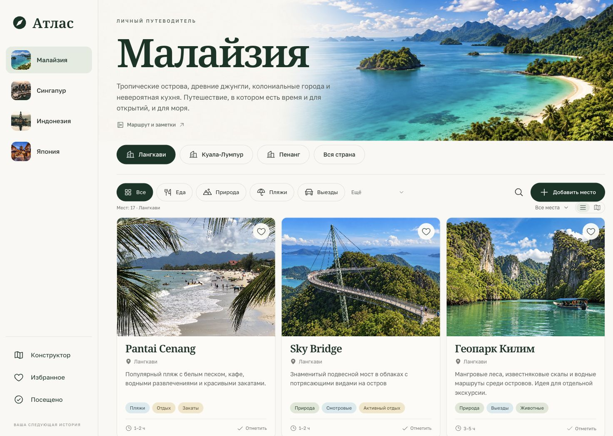

# Атлас — конструктор путешествий

Общий путеводитель на основе [japan-trip](https://github.com/aiden2033/japan-trip) и [winter26](https://github.com/aiden2033/winter26). Четыре страны, единая структура и редактор для следующих поездок.



## Что внутри

| Страна | Города и регионы | Места |
| --- | --- | ---: |
| Малайзия | Лангкави, Куала-Лумпур, Пенанг | 49 |
| Сингапур | Марина-Бэй, старые кварталы, острова и сады | 11 |
| Индонезия | Ява, Ломбок, Гили, Флорес/Комодо, Калимантан | 9 |
| Япония | Осака, Киото, Токио, другие точки | 190 |

Японский каталог включает все 136 исходных мест и 54 точки общего Google Maps списка. Перенесены 45 карточек winter26, три пляжные точки из примечания и добавлен геопарк Килим. Полный исходный HTML сохранён в `docs/archive/winter26.html`. Исходные брони, календарь, аниме-маршруты, подготовка, покупки, транспортные карты и другие материалы Японии доступны через «Маршрут и заметки».

Каталог поддерживает поиск на русском и английском, фильтрацию по тегам, карточки и карту, избранное, посещённые места и ссылки на Google Maps. Исторические цены, даты и правила из старых поездок помечены как исходные заметки; они не являются обновлённым справочником.

## Запуск

Требуется Node.js 22.12+.

```sh
npm ci
npm run dev
```

```sh
npm test
npm run build
npm run preview
```

Приложение статическое: React 18, TypeScript, Vite 8, Tailwind 4, React Router, Fuse.js, Leaflet, Zod. Ключи API для основного приложения не нужны. Относительные пути и HashRouter поддерживают GitHub Pages и обновление глубоких ссылок.

## Конструктор

1. Откройте «Конструктор» и нажмите «Добавить страну».
2. Добавьте города, районы или регионы.
3. Внутри них добавляйте места: название, описание, фотографию, теги, ориентир по времени, координаты и личные заметки.
4. Создавайте свои теги и дополнительные текстовые разделы у страны, города или места — например, «Транспорт», «Где жить», «Бюджет».
5. Меняйте порядок стран, городов и мест стрелками. После удаления доступна отмена.

Коды для ссылок можно задать вручную или оставить пустыми для автоматического создания. При редактировании код сохраняется, чтобы не терять адрес и личные отметки.

**Сохранение — в текущем браузере.** Это не серверный редактор с общим аккаунтом. Устройство или другой браузер не получат изменения автоматически. В конструкторе есть экспорт и импорт JSON: резервная копия включает каталог, избранное, посещения и прежние японские отметки/личные события. Импорт сначала проверяет структуру и предлагает подтвердить замену. Файл ограничен 10 МБ. Не храните в общедоступном каталоге личные документы и секреты.

## Как опубликовать каталог для всех устройств

Экспортируйте резервную копию из конструктора, затем выполните:

```sh
npm run catalog -- apply /path/to/atlas-backup.json
npm test
npm run build
git add src/atlas/published.json
git commit -m "Update travel catalog"
git push
```

Команда сохраняет только каталог в `src/atlas/published.json`. Избранное, посещения и личные календарные события в публикацию не попадают. После push в main GitHub Actions обновит сайт. Уже редактировавшие каталог в браузере пользователи сохраняют свою локальную копию; для замены используйте импорт.

Экспорт чистого текущего каталога из исходников:

```sh
npm run catalog -- export atlas-seed.json
```

Для возврата к исходному набору установите `null` в `src/atlas/published.json`. Структура и проверки находятся в `src/atlas/model.ts`, исходный реестр — в `src/atlas/seed.ts`. Пример дополнительной страны — `docs/country-template.json`; её можно добавить командой `npm run catalog -- add-country docs/country-template.json`. UI позволяет сделать это без ручной правки JSON.

## Данные и расширение

- `src/atlas/model.ts` — версионированные схемы стран, городов, мест, тегов, разделов и резервных копий.
- `src/atlas/seed.ts` — четыре исходные страны, адаптер японского каталога и новые подборки.
- `src/atlas/winter.json` — структурированные карточки и заметки winter26.
- `scripts/migrate-winter.py` — воспроизводимый импорт архивного HTML без сторонних Python-пакетов.
- `src/atlas/Editor.tsx`, `Builder.tsx` — общий редактор для всех стран.
- `src/atlas/published.json` — опубликованный пользовательский каталог, если задан.
- `src/data/` и `src/pages/` — сохранённые японские данные и дополнительные разделы.

Каждая страна может иметь произвольное число городов/регионов. У страны, города и места есть дополнительные разделы `sections: [{ id, title, body }]`. Новые категории определяются в `tags`; отдельные компоненты на каждую страну не требуются.

## Офлайн и синхронизация

После первого открытия production-версия сохраняет оболочку, данные и шрифты через service worker. Просмотренные локальные фотографии и тайлы OpenStreetMap кэшируются отдельно. Внешние фотографии, непросмотренные карты и ссылки на сторонние сервисы требуют интернета. Если внешнее фото недоступно, карточка использует обложку региона.

Старый опциональный backend синхронизации Японии сохранён в исходниках. Он не включён по умолчанию и не является облачной синхронизацией конструктора. Для его использования нужен отдельный сервер и `VITE_SYNC_API_URL` из `.env.example`. До настройки основное приложение не обращается к localhost-серверу.

## GitHub Pages

В `.github/workflows/deploy.yml` настроены проверки, сборка и публикация ветки main. Источник Pages: GitHub Actions. Новый сайт рассчитан на адрес `https://aiden2033.github.io/travel-atlas/`. Префикс репозитория не зашит в приложение.

## Источники и изображения

- [Visit Singapore: идеи маршрута](https://www.visitsingapore.com/travel-tips/travelling-to-singapore/itineraries/7-days-in-singapore/) — стартовый каталог Сингапура, проверен 16.10.2026.
- [Indonesia Travel: Комодо](https://www.indonesia.travel/id/en/travel-ideas/adventure/top-spots-to-shoot-spectacular-photos-in-komodo-national-park).
- [Indonesia Travel: Иджен](https://www.indonesia.travel/id/id/destination/java/east-java/ijen-crater).
- Фото Supertree Grove: Mustang Joe, CC0; Мерлион: Icantthinkofanamexd, CC BY 4.0; National Gallery: Uzoma Ozurumba, CC BY-SA 4.0. Ссылки на оригиналы и лицензии находятся в `src/atlas/credits/*-credit.json` и в карточках мест. При отображении применяется адаптивное кадрирование.
- Обложки Сингапура, Индонезии и Куала-Лумпура: Unsplash; Пенанга и Pantai Cenang — изображения исходных проектов. Их исходные адреса зафиксированы в `docs/assets.md`.
- Баннер Малайзии, Sky Bridge и Килим — иллюстрации, созданные с помощью ИИ. Они предназначены для визуального оформления, а не документального описания мест.
- Иконки: Phosphor Icons. Шрифты: Golos Text и Noto Serif, локальные пакеты Fontsource.

Визуальная проверка: `design-qa.md`. Старое README Японии сохранено в `docs/archive/japan-readme.md`.
