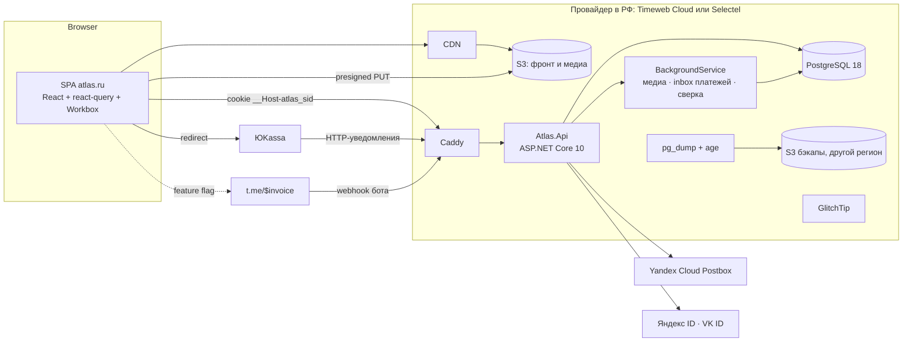

# Бэкенд Атласа: архитектура

Редакция 2 от 19.10.2026, под владельца — резидента РФ (самозанятый или ИП) с русскоязычной аудиторией. Сведено из восьми независимых проработок: домен и API, auth, инфраструктура, миграция фронтенда, альтернатива на managed-сервисах, ЮKassa, Telegram Stars, требования РФ.

Пометки: **[НП]** — не проверено в первоисточнике, **[Ю]** — нужен юрист или налоговый консультант. Это не юридическая консультация.

## 0. Решения коротко

| Вопрос | Решение |
| --- | --- |
| Стек | ASP.NET Core 10 (minimal APIs) + EF Core 10 + PostgreSQL 18, отдельный приватный репо `atlas-api` |
| Хостинг | VPS в РФ (Timeweb Cloud или Selectel) + Docker Compose + Caddy. ≈ 1 200–3 300 ₽ в месяц всего |
| Домен | Свой `.ru`: `atlas.ru` (фронт в S3 + CDN в РФ), `api.atlas.ru`, `media.atlas.ru` |
| Вход | Magic link по email, Яндекс ID, VK ID. **Google и Telegram-вход запрещены** (§1.4) |
| Платный доступ | Продукт = страна. Entitlement проверяется на каждом запросе через кэш 60 с |
| Оплата | **ЮKassa** — основной канал. **Telegram Stars** — за feature flag, включать после консультации (§8.4) |
| Налоговый режим | Старт на НПД с ручными чеками в «Мой налог». ИП на УСН 6% — когда ручные чеки начнут мешать |
| Фото | Публичные, S3 + CDN провайдера в РФ, варианты AVIF/WebP/JPEG 480/800/1200 |
| Почта, ошибки | Yandex Cloud Postbox, GlitchTip self-hosted. Resend, Sentry SaaS, Google Analytics не используются |
| Фронт | react-query вместо localStorage-каталога, Builder/Editor становятся админкой поверх API, seed удаляется из бандла |

## 1. Блокеры до первой строчки кода

### 1.1 Текущий контент уже публичен навсегда

Репозиторий `aiden2033/travel-atlas` публичный. Все 471 место лежат в git history, форках, бандле на Pages и в Wayback. Закрыть их paywall-ом невозможно.

**Решение:** текущие 471 место — бесплатное ядро и витрина. Продаётся **новый** слой, которого никогда не было в git: маршруты по дням, бюджеты, свежие часы и цены, личная проверка, «где жить», секретные места. Он живёт только в БД.

### 1.2 Персональные данные россиян хранятся только в РФ

152-ФЗ, ч. 5 ст. 18 (редакция с 01.07.2025): запись, хранение и извлечение ПД граждан РФ — только в базах на территории РФ. Копия за рубежом допустима только после записи в РФ и как трансграничная передача. Штраф 1–6 млн ₽, ИП платит как юрлицо.

Следствие: Hetzner, Cloudflare R2, Resend и Sentry SaaS из первой редакции не подходят. Их к тому же не оплатить российской картой, а Cloudflare в РФ троттлится до 16 КБ на соединение.

### 1.3 Документы и уведомление РКН до запуска

- Уведомление РКН об обработке ПД через pd.rkn.gov.ru до начала обработки. Штраф для ИП 100–300 тыс. ₽. Как квалифицируется самозанятый — [Ю].
- Политика обработки ПД (ссылка в футере и у каждой формы).
- **Отдельное** согласие на обработку ПД (с 01.09.2025 — отдельным документом и отдельным чекбоксом).
- Публичная оферта на «предоставление доступа к электронным материалам». Условие «деньги не возвращаются» ничтожно (ЗоЗПП ст. 32, ГК ст. 782). Практика: возврат по запросу в течение 14 дней.
- На сайте: ФИО, ИНН, «плательщик НПД», email и телефон, цены, порядок доступа и возврата. Без этого ЮKassa не пройдёт модерацию.

### 1.4 Вход через Google и Telegram запрещён

С 01.12.2023 (ч. 10 ст. 8 149-ФЗ) авторизация российских пользователей допускается только через телефон, Госуслуги, ЕБС или системы российского владельца. С 07.07.2026 действуют штрафы (ст. 13.55 КоАП): граждане 10–20 тыс. ₽, юрлица 500–700 тыс. ₽. РКН письменно назвал вход через Telegram нарушением.

| Способ входа | Решение |
| --- | --- |
| Magic link по email | Основной. По ответу РКН, на который ссылаются юристы, вход по почте не нарушение; в тексте закона email прямо не назван [Ю] |
| Яндекс ID | Подключить первым, работает и за рубежом |
| VK ID | Подключить |
| Google | Убрать. Показывать только для зарубежных IP — [Ю] |
| Telegram OIDC | Убрать. Telegram в РФ к тому же частично замедлен с весны 2026 |

## 2. Общая схема



## 3. Стек

- **.NET 10**: родной язык владельца. Identity, concurrency tokens, HybridCache, rate limiting, Testcontainers — из коробки.
- **TypeScript (Hono + Drizzle)** дал бы общие Zod-схемы, но это единственный плюс. Разрыв закрывается OpenAPI-генерацией (§6.4).
- **Supabase** для этого владельца отпадает: хранение ПД за рубежом нарушает §1.2.

Библиотеки: `Npgsql.EntityFrameworkCore.PostgreSQL`, `EFCore.NamingConventions`, `FluentValidation`, `Microsoft.AspNetCore.OpenApi` + `Scalar.AspNetCore`, `Microsoft.Extensions.Caching.Hybrid`, `Microsoft.Extensions.Http.Resilience`, `AWSSDK.S3` (S3-совместимое хранилище провайдера), `NetVips`, `Ganss.Xss.HtmlSanitizer`, `AspNet.Security.OAuth.Yandex`, `Telegram.Bot` (только для Stars), `Serilog`, `OpenTelemetry`, `Sentry` SDK (отправляет в GlitchTip), `Testcontainers.PostgreSql`, `System.CommandLine`.

## 4. Доменная модель и БД

Общие колонки контентных таблиц: `id uuid v7`, `slug`, `position`, `status (draft|published|archived)`, `created_at`, `updated_at`, `updated_by`, `deleted_at`, `revision int`.

| Таблица | Ключевые колонки | Ограничения |
| --- | --- | --- |
| `countries` | slug, name_ru, name_en, intro, cover_media_id, hero_media_id, `access (free|paid)`, `teaser_mode (none|names|names_photos)` | `UNIQUE(slug)` |
| `cities` | country_id, slug, names, intro, cover_media_id, nights, `stay jsonb`, `tips jsonb`, `access_override` | `UNIQUE(country_id, slug)` |
| `places` | city_id, slug, name_ru/en/ja, description, summary, time_min_h/time_max_h, maps_query, lat/lng, cover_media_id, best_time, note, transport, hours, is_day_trip, day_trip_group, food_spot, source, `anime jsonb`, `links jsonb`, `access_override` | `UNIQUE(city_id, slug)`, CHECK min ≤ max, CHECK координат |
| `place_relations` | place_id, related_place_id, kind (`combines|incompatible`) | FK, PK из трёх колонок |
| `tags`, `place_tags` | slug, label, tone (`green|sand|blue|rose`) | `UNIQUE(slug)` |
| `sections` | ровно один из country_id/city_id/place_id, key, title, body, position, `access_override` | три partial unique |
| `media_assets` | storage_key, status (`pending|ready`), author, license, license_url, source_url, original_url, width, height, cropped, illustrative, caption, sha256 | author/license/license_url/source_url NOT NULL |
| `slug_redirects` | entity_type, old_key, new_entity_id | `UNIQUE(old_key)` |
| `catalog_state` | version bigint | инкремент в той же транзакции, что и любая запись |
| `audit_log` | actor, entity, action, before/after jsonb, request_id | |

**JSONB или таблица:** `stay`, `tips`, `links`, `anime` — JSONB (EF Core `ComplexProperty().ToJson()`). Sections, tags и relations — таблицы: их переупорядочивают, на них ставят доступ, нужны FK.

**Slug неизменяем после публикации.** От него зависят deep links и личные отметки: `stateKey()` в `src/atlas/model.ts` строит `country:city:slug`, для Японии `city:slug`. Меняется только через `POST /rename` и `POST /move`, которые пишут `slug_redirects`. Удалённый slug не переиспользуется. Сервер отдаёт у каждого места готовый `key`.

**Черновики:** новые сущности создаются как `draft`, правки опубликованного видны сразу, откат — из `audit_log.before`.

## 5. Доступ и paywall

```
effective_access = coalesce(section.override, place.override, city.override, country.access)
unlocked = effective_access = free OR есть активный entitlement на страну
```

Так в платной стране работают 3–5 бесплатных мест-тизеров, а в бесплатной можно сделать платный город или раздел «Где жить».

Набор купленных стран кэшируется (`HybridCache`, ключ `ent:{userId}`, TTL 60 с, сброс из webhook и admin grant). У каждой страны два варианта ответа — locked и unlocked, оба собираются один раз на `catalog_state.version`.

**Locked-место (200, не 403):** `id, key, slug, nameRu, nameEn, city, tags, photo + атрибуция, summary ≤ 200 символов, timeEstimateHours, locked: true, productIds`. Не отдаются description, sections, note, bestTime, transport, hours, links, mapsQuery, combinesWith и координаты.

Один `PlaceProjector.ToDto(place, accessSet)` во всех эндпоинтах; интеграционный тест на каждый эндпоинт проверяет, что закрытые поля отсутствуют.

## 6. API

### 6.1 Публичное и личное

| Endpoint | Кэш | Что |
| --- | --- | --- |
| `GET /v1/public/catalog` | `public, max-age=60, swr=86400`, ETag | Версия, теги, страны: slug, имена, обложка, access, число мест, цены |
| `GET /v1/public/countries/{slug}` | public, ETag | Страна целиком, платное — тизерами |
| `GET /v1/me/countries/{slug}` | `private, no-cache` | Страна с учётом entitlements |
| `GET /v1/me` | NetworkOnly | Пользователь, роли, entitlements, csrf-токен |
| `GET/PUT /v1/me/flags` | private | favorites/visited/booked по `place_id` + `legacyKey` |
| `POST /v1/orders`, `GET /v1/orders/{id}`, `POST /v1/orders/{id}/refund-request` | — | Покупка (§8) |
| `GET /v1/redirects?key=` | public | Разрешение старых ключей |

Публичные и персональные данные разнесены по URL, чтобы service worker не отдал одному пользователю ответ другого. Пагинация не нужна: самая большая страна (Япония, 189 мест) — около 50 КБ после brotli. Поиск остаётся на клиенте (Fuse.js).

### 6.2 Админка `/v1/admin/*` (policy `CatalogWrite`)

| Операция | Endpoint |
| --- | --- |
| CRUD | `/countries`, `/countries/{id}/cities`, `/cities/{id}/places`, `/tags`, `/{owner}/{id}/sections` |
| Место целиком | `PUT /places/{id}`: поля + теги + sections + links + relations одной транзакцией |
| Порядок | `PUT /cities/{id}/places/order {ids, revision}` |
| Slug | `POST /places/{id}/rename`, `POST /places/{id}/move` |
| Статус | `POST /{entity}/{id}/publish|unpublish|restore` |
| Медиа | `POST /media/uploads` → presigned PUT; `POST /media/{id}/complete` с лицензией; `POST /media/import-commons` |
| Импорт/экспорт | `POST /import?mode=dry-run|apply` в формате `backupSchema`, ответ — diff; `GET /export` |
| Продажи | CRUD `/products`, `POST /entitlements` (подарок), `POST /orders/{id}/refund`, `POST /orders/{id}/chargeback` |
| Чеки НПД | `GET /receipts?status=pending`, `POST /receipts/{id}/issued {receiptUrl}` (§8.3) |
| Аудит | `GET /audit?entity=&id=` |

### 6.3 Конкурентные правки

Явная колонка `revision` вместо `xmin` (`xmin` меняется и при reorder). GET отдаёт `ETag: "r{revision}"`, запись требует `If-Match`: без него 428, при расхождении 412 с текущей версией.

### 6.4 Контракт фронт ↔ бэк

- OpenAPI 3.1 → `contracts/openapi.json`, diff-check в CI.
- Фронт: `openapi-typescript` + `openapi-fetch`, хуки react-query руками.
- Паритет валидации: `contracts/fixtures/{valid,invalid}/*.json` прогоняются и через Zod, и через FluentValidation.
- `JsonIgnoreCondition.WhenWritingNull`, чтобы отсутствующее поле совпадало с `.optional()` в Zod.

## 7. Auth и роли

- **Вход:** magic link (TTL 15 мин, одноразовый, в БД hash), Яндекс ID (`AspNet.Security.OAuth.Yandex`), VK ID (OAuth 2.1 + PKCE через generic `AddOAuth`: готовый пакет Vkontakte рассчитан на старый API [НП]). Пароль не нужен. Passkeys — вторым этапом.
- **Привязка аккаунтов:** автоматически только при совпадении подтверждённого email, иначе явная привязка из залогиненной сессии.
- **Сессия:** `__Host-atlas_sid; HttpOnly; Secure; SameSite=Lax`, серверные сессии в Postgres (`ITicketStore`): отзыв, «выйти везде», не больше 5 сессий. Sliding 14 дней, absolute 60.
- **CSRF:** проверка `Origin` на всех не-GET + antiforgery-токен из `GET /v1/me` в `X-CSRF-Token`. CORS — точный allowlist + `AllowCredentials`.
- **Rate limiting:** magic-link 3 за 10 мин на IP и на email. Капча — Yandex SmartCaptcha (Cloudflare Turnstile — зарубежный сервис).
- **Удаление аккаунта:** `DELETE /v1/me` — сразу анонимизация, удаление через 30 дней; покупки остаются псевдонимизированными для налоговой отчётности.

| Роль | Права |
| --- | --- |
| user | бесплатное + купленное, личные данные |
| editor | `CatalogWrite` |
| admin | всё + `UsersManage`, `EntitlementsGrant`, `ProductsManage`, refunds, чеки |

Для editor и admin обязательна 2FA (TOTP или passkey). Первый админ создаётся CLI-командой `admin grant --email`.

## 8. Оплата

### 8.1 Налоговый режим и чеки

**С 29.12.2025 ЮKassa больше не регистрирует чеки самозанятых в «Мой налог».** Приём платежей для НПД работает, но каждый чек самозанятый оформляет сам.

| | НПД (самозанятый) | ИП, УСН «доходы» 6% |
| --- | --- | --- |
| Налог | 4% с физлиц | 6% + фиксированные взносы ≈ 57 тыс. ₽ в год [НП] |
| Лимит | 2,4 млн ₽ в год; по картам до 500 тыс. ₽ в месяц | нет |
| Комиссия ЮKassa (карты, SberPay, T-Pay, ЮMoney) | 3,5% + НДС с комиссии ≈ 4,27% | 2,8% + 1% за чеки + НДС [НП в трактовке «1%»] |
| СБП | индивидуально | индивидуально |
| Чеки | вручную в «Мой налог» (§8.3) | автоматически, «Чеки от ЮKassa» по 54-ФЗ |
| Подключение | email, телефон, ИНН, «от 1 дня» | + ОГРНИП и расчётный счёт, 1–3 дня [НП] |

**Рекомендация:** стартовать на НПД, пока продаж меньше 30–50 в месяц, и выбивать чеки по списку из админки. Чек по безналичной оплате можно сформировать до 9-го числа следующего месяца [НП]. Переходить на ИП, когда ручные чеки начнут мешать или выручка подойдёт к 1,5–2 млн ₽ в год. Альтернатива на НПД с автоматическими чеками — Robokassa («Робочеки СМЗ»): подключается вторым `IPaymentProvider` без изменений модели.

### 8.2 Таблицы

| Таблица | Колонки |
| --- | --- |
| `products` | sku, kind (`country`, позже `bundle`), `price_rub`, `price_stars null` (NULL — Stars недоступны), `duration_days null` = навсегда, active |
| `product_scopes` | product_id, scope_type, scope_id |
| `orders` | user_id, product_id, provider (`yookassa|telegram_stars`), status (`pending|paid|refunded|chargeback|canceled`), currency (`RUB|XTR`), amount_minor, refunded_amount, provider_txn_id UNIQUE, attempt, confirmation_url, payer_external_id, cancel_reason, offer_version, offer_accepted_at, ip |
| `entitlements` | user_id, scope, source (`purchase|grant|promo`), source_id, expires_at, revoked_at |
| `payment_events` | provider, event_id, payload, received_at, processed_at, error; `UNIQUE(provider, event_id)` |
| `npd_receipts` | order_id, kind (`income|cancel`), amount, payer (`individual|foreign_org`), status (`pending|issued`), receipt_url, due_date, issued_at |

`offer_version`, `offer_accepted_at` и `ip` — доказательная база при чарджбэке и споре о возврате.

### 8.3 ЮKassa — основной канал

**Поток:**

1. SPA: `POST /v1/orders {productId, provider: "yookassa"}`. Цена считается только на сервере; при активном entitlement — 409.
2. API создаёт `orders(pending)` и `POST https://api.yookassa.ru/v3/payments`:
   ```json
   {
     "amount": { "value": "490.00", "currency": "RUB" },
     "capture": true,
     "confirmation": { "type": "redirect", "return_url": "https://atlas.ru/?checkout=return&order={id}#/guide/japan" },
     "description": "Атлас: гид «Япония», заказ {id}",
     "metadata": { "order_id": "{id}", "user_id": "{userId}" }
   }
   ```
   Заголовок `Idempotence-Key: {order.id}:{attempt}`. Ключ живёт 24 ч, поэтому новая попытка на тот же заказ разрешена только после `canceled` и получает новый `attempt`. `payment_method_data` не передаётся — способ выбирает пользователь.
3. SPA уходит на `confirmation_url`. Redirect, а не виджет: страница ЮKassa надёжнее отрабатывает выбор банка в СБП, deeplink в SberPay/T-Pay и 3-DS из PWA в standalone-режиме. Встроенный виджет — вторым этапом.
4. ЮKassa возвращает пользователя на `return_url` **при любом исходе**, поэтому параметр называется `checkout=return`, а не `success`. SPA опрашивает `GET /v1/orders/{id}`: каждые 2 с, потом реже, до 60 с, плюс refetch на `visibilitychange`. Сохранность `#/…` в return_url проверить на тестовом магазине [НП].
5. HTTP-уведомление → §8.3.1.
6. Отмена показывает пользователю причину из `cancellation_details.reason` (`insufficient_funds`, `3d_secure_failed`, `country_forbidden`, `expired_on_confirmation` …).

**8.3.1 Уведомления.** Настраиваются в личном кабинете («Интеграция → HTTP-уведомления»), только HTTPS на 443/8443. События: `payment.succeeded`, `payment.canceled`, `refund.succeeded`, `payment.waiting_for_capture` (для алерта).

**Подписи у ЮKassa нет**, поэтому:

1. IP проверяется по allowlist: `185.71.76.0/27`, `185.71.77.0/27`, `77.75.153.0/25`, `77.75.156.11`, `77.75.156.35`, `77.75.154.128/25`, `2a02:5180::/32`. За Caddy — `ForwardedHeaders` с `KnownProxies`.
2. `INSERT payment_events (event_id = "{event}:{object.id}") ON CONFLICT DO NOTHING` — у уведомления нет собственного id. Сразу 200. Без 200 ЮKassa повторяет доставку 24 ч.
3. Фоновый worker **всегда перезапрашивает** `GET /v3/payments/{id}` и решает только по ответу API. Сверяет `amount`, `currency`, `metadata.order_id`, флаг `test`.

**8.3.2 Машина состояний.**

| ЮKassa | orders | Действие |
| --- | --- | --- |
| `pending` | pending | — |
| `succeeded` | pending или canceled → **paid** | entitlement в той же транзакции, сброс кэша, письмо-квитанция, строка в `npd_receipts` |
| `canceled` | pending → canceled | сохранить `cancel_reason` |
| `waiting_for_capture` | — | алерт: при `capture: true` его быть не должно |
| `refund.succeeded`, полный | paid → refunded | revoke entitlement, `npd_receipts(kind=cancel)` |
| `refund.succeeded`, частичный | paid | `refunded_amount += x`, доступ остаётся |
| чарджбэк | paid → chargeback | вручную из админки, revoke |

`succeeded` переводит заказ в paid **всегда**, даже если локально он canceled: деньги уже списаны. `refunded` терминален.

**8.3.3 Возвраты и чарджбэки.** `POST /v3/refunds {payment_id, amount}`, `Idempotence-Key` = id запроса на возврат. Комиссия ЮKassa при возврате не возвращается. Чарджбэков в API нет: приходит письмо, спор появляется в кабинете. Самостоятельно возвращать деньги по спору нельзя — будет двойная выплата.

**8.3.4 Чеки на ИП** (когда понадобится). В тело платежа добавляется:

```json
"receipt": {
  "customer": { "email": "{email}" },
  "items": [{
    "description": "Доступ к гиду «Япония»",
    "quantity": 1.000,
    "amount": { "value": "490.00", "currency": "RUB" },
    "vat_code": 1,
    "payment_mode": "full_payment",
    "payment_subject": "service",
    "measure": "piece"
  }],
  "internet": "true"
}
```

`vat_code: 1` — без НДС на УСН до 20 млн ₽. `full_payment`, а не `full_prepayment`: доступ выдаётся сразу, второй чек не нужен. `payment_subject: service` против `intellectual_activity` — согласовать с бухгалтером [Ю]. При частичном возврате нужен `receipt` на сумму возврата, при полном ЮKassa формирует его сама.

**8.3.5 Иностранные карты.** ЮKassa принимает только карты партнёров НСПК, по сути «Мир». Visa и Mastercard иностранных банков получат отказ `country_forbidden`. Экспаты платят российской картой «Мир», через SberPay/T-Pay или СБП в приложении российского банка.

**8.3.6 .NET.** Свой typed `HttpClient` вместо `Yandex.Checkout.V3` (последнее обновление 03.2025): эндпоинтов около пяти. Basic-auth `shopId:secretKey`, `JsonNamingPolicy.SnakeCaseLower`, `Microsoft.Extensions.Http.Resilience`: retry на сетевые ошибки и 5xx с тем же `Idempotence-Key`, timeout 40 с. HTTP 500 у ЮKassa означает «не уложились в 30 с» — запрос повторяется.

**Тестовый магазин** (свои shopId и ключ, `"test": true` в ответах): карты `5555555555554477` (с 3-DS), `4111111111111111` и `2202474301322987` (без 3-DS), `5555555555554600` (`insufficient_funds`). СБП в тесте недоступен.

### 8.4 Telegram Stars — за feature flag

**Почему не на старте:**

| Проблема | Суть |
| --- | --- |
| Деньги | Разработчик получает $0,013 за ⭐, покупатель платит ≈ $0,02. После вывода через Fragment и конвертации TON доходит ≈ 45–55% цены. У ЮKassa теряется ≈ 4% |
| Закон | 259-ФЗ ст. 14 ч. 5 запрещает резидентам принимать цифровую валюту в оплату товаров и услуг. Вывод Stars идёт только в TON. Позиции ФНС именно по Stars нет [Ю] |
| Налоги | Кто плательщик для НПД — физлица или Telegram как иностранная организация (ставка 6%); как считать рубли на дату получения TON [Ю] |
| Вывод | Fragment: минимум 1 000 ⭐, холд 21 день, KYC через Sumsub, отказы без объяснений. Доступность для аккаунтов из РФ не проверена [НП] |
| Доступность | Telegram в РФ частично замедлен; оплатить Stars российской картой можно только через неофициальные каналы |

**Кому полезен:** русскоязычным экспатам без карты «Мир» и аудитории внутри Telegram. Если включать, то после заключения налогового консультанта.

**Поток** (сайт → инвойс-ссылка; бот-first и Mini App сложнее и не нужны):

1. `POST /v1/orders {productId, provider: "telegram_stars"}` → `createInvoiceLink(title, description, payload = order.id, provider_token = "", currency = "XTR", prices = [{label, amount = price_stars}])`.
2. SPA открывает `https://t.me/$…` и опрашивает заказ, как в §8.3.
3. `pre_checkout_query` — ответ **за ≤ 10 с синхронно в теле ответа на webhook** (`{"method":"answerPreCheckoutQuery",…}`): заказ pending, сумма и валюта совпадают, товар активен, entitlement ещё нет, заказ моложе 24 ч.
4. `message.successful_payment` → inbox (`event_id = "pay:{telegram_payment_charge_id}"`) → paid → entitlement → бот пишет «Доступ открыт» со ссылкой на сайт. `from.id` сохраняется в `payer_external_id`: без него не сделать возврат.

Привязывать Telegram к аккаунту сайта не нужно: заказ создан под залогиненным пользователем, `payload` его однозначно указывает.

**Webhook:** `setWebhook(url = https://api.atlas.ru/v1/webhooks/telegram/{pathSecret}, secret_token, allowed_updates = ["message", "pre_checkout_query"])`. Заголовок `X-Telegram-Bot-Api-Secret-Token` сравнивается через `CryptographicOperations.FixedTimeEquals` до парсинга JSON.

**Возврат:** `refundStarPayment(payer_external_id, provider_txn_id)` → приходит `message.refunded_payment` → refunded + revoke. Споры разбирает разработчик через `/paysupport`. Возвраты сторами за покупку Stars Telegram может списать с баланса бота без отдельного события — ловится только сверкой.

**Сверка:** каждые 15 мин `getStarTransactions(offset, limit ≤ 100)`, входящие с `invoice_payload = order.id` сверяются с заказами.

**Обязательно для бота:** команды `/paysupport` и `/terms`, 2FA на аккаунте владельца.

**Цена:** 250 ⭐ за продукт ценой 490 ₽ — паритет для покупателя. На руки ≈ 230–270 ₽. Поднимать цену в Stars до «тех же 490 ₽ на руки» не стоит: экспаты сравнивают её с ценой на сайте.

**Гонка каналов:** pre-checkout отклоняет оплату при уже выданном entitlement. Если обе оплаты всё же прошли — автоматический возврат второй.

**Альтернатива для иностранных карт** с комиссией ≈ 10% и выплатой в рублях без крипты: Lava.top, Prodamus International. Применимость к конкретному продукту и статусу владельца не проверена [НП]. Подключаются тем же `IPaymentProvider`.

### 8.5 Код

```
Atlas.Api/Features/Billing/
  IPaymentProvider.cs           CreateCheckout, VerifyAndParseWebhook, FetchOrderState, Refund
  OrderStateMachine.cs          общие переходы и выдача entitlement
  YooKassa/YooKassaClient.cs    typed HttpClient + DTO records
  YooKassa/YooKassaProvider.cs
  YooKassa/YooKassaWebhook.cs   IP allowlist → inbox → 200
  TelegramStars/TelegramStarsProvider.cs
  TelegramStars/TelegramWebhook.cs   pre_checkout синхронно, остальное → inbox
  PaymentInboxWorker.cs         обработка payment_events
  ReconciliationJob.cs          ЮKassa: pending старше 3 мин каждые 5 мин,
                                GET /v3/payments?created_at.gte=now-48h ежечасно;
                                Stars: getStarTransactions каждые 15 мин
```

Конфигурация: `YooKassa:ShopId`, `YooKassa:SecretKey`, `YooKassa:WebhookAllowedCidrs[]`, `YooKassa:Receipts:Mode = None|YooKassaChecks`, `Payments:TelegramStars:Enabled`, `TelegramStars:BotToken`, `TelegramStars:WebhookSecretToken`, `TelegramStars:WebhookPathSecret`, `Payments:OrderTtl = 24h`.

**Алерты** (в email или в Telegram-канал владельца):

- платёж `succeeded` у провайдера, а заказ не paid, или наоборот;
- расхождение суммы или `order_id`;
- уведомление с IP не из allowlist;
- нет уведомлений N часов при наличии платежей;
- `waiting_for_capture` или рост `fraud_suspected`;
- чек НПД не оформлен до `due_date`;
- доход НПД с начала года больше 2 млн ₽ (запас до лимита 2,4 млн).

**Тесты:** повтор одного уведомления (дедупликация), уведомление с чужого IP, `succeeded` после локального `canceled`, полный и частичный возврат, pre-checkout на оплаченный заказ (`ok = false`), сверка находит пропущенный платёж.

## 9. Медиа

- **Хранилище:** S3 провайдера в РФ (Timeweb: 100 ГБ — 349 ₽ в месяц, 100 ГБ исходящего трафика включено) + его CDN на `media.atlas.ru`.
- **Загрузка из админки:** presigned PUT в `incoming/{uuid}` (TTL 10 мин, тип и размер подписаны, ≤ 30 МБ) → `complete` с обязательной лицензией (без неё 422) → фоновая обработка.
- **Обработка (NetVips):** проверка magic bytes и ≤ 60 Мп, auto-orient, strip EXIF, crop 3:2, ширины 480/800/1200, AVIF + WebP + JPEG. Ключи `p/{assetId}/{hash}-{w}.{fmt}`, `Cache-Control: immutable`.
- **Импорт с Commons:** порт `scripts/add-commons-photos.mjs` на C#. Сейчас скрипт режет через macOS `sips` и работает только на Mac.
- **Фото не закрываются.** Это CC BY/BY-SA, ГК ст. 1286.1 признаёт открытые лицензии, коммерческое использование разрешено. Технические меры защиты на изображения запрещены (CC 4.0 §2a5). Атрибуция и пометка «изменено» видны всем. Проверять снимки с людьми в кадре (ГК ст. 152.1) и скульптурами (ст. 1276).
- **Карта:** `src/atlas/GuideMap.tsx:46` берёт тайлы с `tile.openstreetmap.org`. Персональных данных они не получают, но при проблемах доступности можно перейти на тайлы российского провайдера.

## 10. Инфраструктура

| Статья | ₽ в месяц |
| --- | --- |
| VPS 2 vCPU / 4 ГБ (API + PostgreSQL + GlitchTip), Timeweb Cloud или Selectel | 1 000–2 500 [сверить в калькуляторе] |
| S3: медиа, фронт, бэкапы (≤ 100 ГБ) | 80–350 |
| CDN (≤ 100 ГБ) | 0–300 [НП] |
| Yandex Cloud Postbox (≤ 2 000 писем) | 0 |
| Registry провайдера, CI | 0–100 |
| Домен `.ru` | 20–75 |
| **Итого** | **≈ 1 200–3 300** |

Разово: шаблоны документов или проверка у юриста ≈ 5–20 тыс. ₽ [НП]. Managed PostgreSQL (+2–6 тыс. ₽) — когда появятся продажи.

- **БД:** EF Core migrations → `efbundle` в образе, сервис `migrate` в compose перед `api`. Ночной `pg_dump -Fc` → `age` → S3 **в другом регионе РФ**, хранение 30 дней. Ежемесячный автоматический restore-test.
- **CI:** GitHub Actions работает. Образы пушатся в registry провайдера в РФ (GitHub из РФ с мая 2026 нестабилен, сервер не должен тянуть образы из GHCR). Деплой: SSH → `docker compose pull && up -d` → проверка `/health/ready`, при провале откат.
- **Секреты:** sops + age, ключ на сервере. Секреты не попадают в публичный репо фронта.
- **Наблюдаемость:** Serilog JSON, GlitchTip self-hosted (≈ 1 ГБ RAM, Sentry SDK совместим), Uptime Kuma. Внешний пинг без ПД может оставаться зарубежным.
- **Почта:** Yandex Cloud Postbox, поддомен `mail.atlas.ru`, SPF/DKIM/DMARC, Postmaster Mail.ru и Яндекса. Локально Mailpit.
- **Аналитика:** только Яндекс Метрика и только после согласия в cookie-баннере «Принять / Отклонить». Google Analytics нельзя.
- **Фронтенд:** переезжает с GitHub Pages в S3 + CDN в РФ на `atlas.ru` (GitHub Pages в РФ с мая 2026 даёт 10–16% неудачных подключений). Pages остаётся для превью. HashRouter можно заменить на BrowserRouter.
- **Локальная разработка:** `compose.yaml` (postgres, mailpit), `LocalDiskStorage` вместо S3. Во фронте `server.proxy: { '/v1': 'http://localhost:5080' }`. Уведомления ЮKassa на локальную машину — через туннель (cloudflared или ngrok).

### Структура репо `atlas-api`

```
atlas-api/
  src/Atlas.Api/         Program.cs; Features/{Catalog,Countries,Places,Admin,Media,Me,Billing,Auth}/
                         endpoint + DTO records + validator в одной фиче
  src/Atlas.Data/        AtlasDbContext, Entities, Configurations, Migrations,
                         Interceptors/{Audit,Revision,CatalogVersion}
  src/Atlas.Tools/       import/export CLI, admin grant, set-telegram-webhook
  tests/Atlas.Api.Tests/ WebApplicationFactory + Testcontainers, round-trip import/export,
                         платёжные сценарии, паритет фикстур
  contracts/             openapi.json, fixtures/{valid,invalid}
  deploy/                compose.prod.yml, Caddyfile, backup/, secrets.prod.enc.env
  compose.yaml  justfile  global.json  Directory.Build.props  Directory.Packages.props
  .github/workflows/     ci.yml, release.yml, restore-test.yml
```

## 11. Переезд фронтенда (порядок PR)

| # | PR | Тесты |
| --- | --- | --- |
| 1 | Удалить мёртвые `vite.config.js`, `vite.config.d.ts`, `JapanApp.tsx`; `src/api/client.ts` (openapi-fetch + CSRF), `VITE_API_URL`, dev proxy | unit на CSRF и ошибки |
| 2 | Шов данных: `useCatalogIndex`, `useCountry`, `usePlacesByKeys` поверх seed; переписать `App.tsx`, `Guide.tsx`, `Builder.tsx` | `model.test.ts` зелёный |
| 3 | Модель `GuidePlace` → union locked/full; locked-варианты PlaceCard, деталей, карты, CTA | testing-library: тизер не рендерит description |
| 4 | Вход: magic link, Яндекс ID, VK ID; `/login`, `/account`; `RequireRole` для `/builder`; убрать Telegram-виджет из `src/pages/Account.tsx` | guard, logout чистит кэши |
| 5 | Источник API за флагом `VITE_CATALOG_SOURCE`, skeleton и ошибки | msw |
| 6 | Workbox: `/v1/public` StaleWhileRevalidate, `/v1/me` NetworkFirst, admin/auth NetworkOnly; очистка при logout | matcher-функции |
| 7 | Покупка: выбор способа (ЮKassa, Stars за флагом), чекбоксы оферты и согласия на ПД, `?checkout=return`, polling, причины отказа | fake timers |
| 8 | Юридические страницы: оферта, политика ПД, согласие, реквизиты; cookie-баннер, Метрика после согласия | — |
| 9 | Админ-мутации вместо `update()`, диалог 412, soft-delete undo; список чеков НПД | rollback optimistic |
| 10 | Загрузка фото с лицензией | валидация |
| 11 | Sync флагов через `/v1/me/flags`, слияние при первом логине | union, LWW |
| 12 | Cutover: перестать читать `atlas:catalog:v1`, backup v2 только с личными данными; удалить seed из бандла, CI-проверка утечки в `dist/`; переезд на `atlas.ru` | Playwright e2e |

Что сломается: `migrations.ts` продолжит подсовывать старую локальную копию, если её не отключить; `published.json` и `npm run catalog` теряют смысл; `withLicensedPhotos` переезжает в бэкенд; `model.test.ts` и `photos.test.ts` импортируют seed; `Collection` обходит все страны и требует `usePlacesByKeys`; `exportData` сейчас выгружает весь каталог.

Японские материалы поездки (`src/data/*`, `src/pages/*`) в каталог не входят. Личные данные поездки (`trip.ts`, брони) стоит убрать из публичного репо в любом случае.

## 12. Проверка спроса до бэкенда

Лендинг страны с 10 бесплатными карточками и кнопкой «Полный гид — 490 ₽». Оплата по ссылке ЮKassa без своего бэкенда (платёжная ссылка из личного кабинета), покупатель получает PDF. 2–3 дня работы. Меньше 5 продаж за месяц при живом трафике из русскоязычных travel-каналов — бэкенд не нужен.

**Отложить при любом варианте:** подписки и бандлы, роли кроме admin, платные фото, промокоды, встроенный виджет ЮKassa, Telegram Stars, возвраты через UI покупателя.

## 13. Этапы

| Этап | Что | Фокусные дни |
| --- | --- | --- |
| 0 | НПД, домен `.ru`, аккаунт у провайдера, документы, уведомление РКН | — (1–2 недели календарно) |
| 1 | Репо, CI, compose, схема БД, импорт каталога (round-trip тест), публичный read API | 4–5 |
| 2 | Magic link, Яндекс ID, VK ID, роли, `/v1/me` | 3–5 |
| 3 | Фронт PR 1–6: API-источник, вход, locked-варианты | 4–5 |
| 4 | Admin API + Builder/Editor на API, медиа-конвейер, перенос 471 фото | 4–6 |
| 5 | ЮKassa: заказы, уведомления, сверка, возвраты, чеки НПД; фронт PR 7–8 | 4–5 |
| 6 | Деплой в РФ, бэкапы, GlitchTip, cutover, переезд фронта на `atlas.ru` | 3–4 |
| 7 | Telegram Stars — после консультации | 2–3 |
| | **Итого без Stars** | **≈ 22–30** |

Первая продажа возможна после этапа 5. Полноценная админка для неё не обязательна: новый платный контент заливается через `POST /admin/import`.

## 14. Где проработки разошлись и что выбрано

| Вопрос | Варианты | Выбрано |
| --- | --- | --- |
| Свой .NET или Supabase | .NET / Supabase | .NET: Supabase хранит ПД за рубежом |
| Хостинг | Hetzner / РФ-провайдер | РФ-провайдер: 152-ФЗ и оплата |
| Второй канал оплаты | Stars / Lava.top, Prodamus | ЮKassa на старте; Stars за флагом по запросу владельца, после консультации |
| Координаты locked-места | убрать / округлить | убрать; округление через `teaser_mode` |
| Один URL страны или два | ETag + `Vary` / `/public` и `/me` | два URL |
| ЮKassa: redirect или виджет | | redirect, виджет позже |

## 15. Открытые вопросы

**Владельцу:**

1. Что именно продаётся: только новый контент или и текущий с осознанной утечкой старых версий?
2. Сделать ли `travel-atlas` приватным (Pages из приватного репо требует GitHub Pro, но фронт и так переезжает в РФ)?
3. Цена и форма: навсегда за страну или годовой пропуск без автопродления?

**Юристу или налоговому консультанту:**

1. Штрафы по ПД для самозанятого: гражданские или как для ИП.
2. Формулировка оферты и правил возврата.
3. Вход по email и показ Google-входа только для зарубежных IP.
4. Telegram Stars: 259-ФЗ, плательщик и ставка НПД, учёт TON.
5. `payment_subject` в чеке ИП: `service` или `intellectual_activity`.

## 16. Источники

- ЮKassa: [уведомления](https://yookassa.ru/developers/using-api/webhooks), [процесс платежа](https://yookassa.ru/developers/payment-acceptance/getting-started/payment-process), [отказы](https://yookassa.ru/developers/payment-acceptance/after-the-payment/declined-payments), [возвраты](https://yookassa.ru/developers/payment-acceptance/after-the-payment/refunds), [чеки 54-ФЗ](https://yookassa.ru/developers/payment-acceptance/receipts/54fz/yoomoney/payments), [чеки самозанятых](https://yookassa.ru/developers/payment-acceptance/receipts/self-employed/basics), [тестирование](https://yookassa.ru/developers/payment-acceptance/testing-and-going-live/testing), [тарифы](https://yookassa.ru/fees/), [чарджбэки](https://yookassa.ru/docs/support/payments/chargeback)
- Telegram: [Stars](https://core.telegram.org/bots/payments-stars), [Bot API](https://core.telegram.org/bots/api), [ToS для разработчиков](https://telegram.org/tos/bot-developers)
- ПД и авторизация: [локализация](https://habr.com/ru/articles/943422), [уведомление РКН](https://ppt.ru/art/personal-data/shtraf-za-nepodachu-uvedomleniya-ob-obrabotke-personalnykh-dannykh), [согласие с 01.09.2025](https://harant.ru/blog/internet-pravo/chto-izmenilos-s-1-sentyabrya-2025-goda-v-oblasti-personalnyh-dannyh-dlya-onlajn-biznesa/), [штрафы 199-ФЗ](https://www.garant.ru/article/2136195/), [вход через иностранные сервисы](https://ppc.world/articles/shtrafy-za-avtorizaciyu-cherez-inostrannye-servisy-komu-grozyat-i-kak-ih-izbezhat/)
- Инфраструктура: [Timeweb VPS](https://timeweb.cloud/services/cloud-servers), [Timeweb S3](https://timeweb.cloud/services/s3-storage), [Selectel](https://selectel.ru/services/cloud/servers/), [Postbox](https://yandex.cloud/ru/docs/postbox/pricing), [Cloudflare в РФ](https://3dnews.ru/1120695/roskomnadzor-porekomendoval-otkazatsya-ot-ispolzovaniya-resheniya-cloudflare-narushayushchego-zakoni-rf), [GitHub в РФ](https://ru.themoscowtimes.com/2026/05/08/v-rossii-nachali-blokirovat-odnu-iz-krupneishih-platform-dlya-programmistov-a194903)
