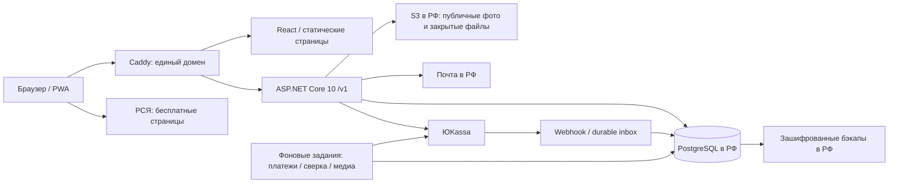

# Атлас: монетизация и план развития бэкенда

Исследование от 28 октября 2026. Подтверждённый контекст: продавец в РФ, аудитория преимущественно русскоязычная, предпочтительный язык — C#.

## 1. Рекомендация

Развивать Атлас как редакционный сервис самостоятельных путешествий: бесплатные подборки привлекают аудиторию, реклама монетизирует бесплатное чтение, платный пакет страны экономит время подготовки поездки.

Техническая основа: существующий `../atlas-api` на ASP.NET Core 10 + EF Core + PostgreSQL. Его стоит проверить и подключить к текущему React-приложению. Новый бэкенд с нуля не требуется. Первый коммерческий релиз — одна страна, один платный пакет, один платёжный провайдер, без подписки с автосписанием. Далее — отдельные путеводители и дополнительные подборки как самостоятельные товары.

Первый пакет предлагаю продавать как **12 месяцев доступа к расширенному каталогу и веб-путеводителю страны, без автопродления**. Это гипотеза продукта, а не установленный спрос. Цена 490–990 ₽ — диапазон для эксперимента, не рыночная оценка. Перед покупкой должны быть понятны состав пакета, дата проверки материалов, срок доступа и условия обновления.

## 2. Что сервис представляет собой сейчас

Это статический PWA с редакционным каталогом, картой и инструментами подготовки поездки. В текущем checkout нет работающего серверного источника каталога.

| Страна | Города / регионы | Места |
| --- | ---: | ---: |
| Малайзия | 3 | 92 |
| Сингапур | 6 | 46 |
| Индонезия | 12 | 90 |
| Япония | 4 | 189 |
| Австралия | 8 | 54 |
| Всего | 33 | 471 |

Числа получены исполнением `seed` из исходников, а не копированием старой архитектуры. В ней местами осталось устаревшее утверждение о 471 месте ещё до добавления Австралии.

### Как движутся данные

1. `src/atlas/seed.ts` собирает данные из японского каталога, winter26 и дополнительных подборок; учитывает `published.json` и фотоманифест.
2. `CatalogProvider` в `src/atlas/store.tsx` берёт каталог из `localStorage` либо из seed, выполняет миграции и подставляет лицензированные фотографии.
3. `Guide.tsx` строит страницы стран и городов, фильтрует места, использует Fuse.js для поиска. `ui.tsx` показывает карточки и подробности, `GuideMap.tsx` — карту Leaflet.
4. Избранное, посещения и бронирования хранятся локально. Экспорт резервной копии включает весь каталог и личные отметки.
5. Конструктор и редактор существуют, но изменение каталога остановлено константой `CATALOG_READ_ONLY`. Это ограничение интерфейса, не серверная авторизация.
6. Старые японские страницы содержат отдельные материалы поездки, календарь, брони, подготовку и покупки. Они подключены через lazy imports.
7. Workbox сохраняет оболочку приложения; просмотренные локальные изображения и тайлы карты кэшируются отдельно. Это не гарантированная загрузка всей страны для офлайна.
8. GitHub Actions публикует сборку на GitHub Pages. Используется `HashRouter`, HTML изначально содержит только контейнер React и общие метаданные.

Стек фронтенда: React 18, TypeScript, Vite, Tailwind, React Router, TanStack Query, Zod, Fuse.js, Leaflet. Переписывать его на Blazor ради C# нецелесообразно: бэкенд можно добавить независимо.

`src/main.tsx` уже подключает старые `AuthProvider` и `SyncProvider`. Однако они используют `/api/auth/*` и `/api/sync/*`; запрос начальной авторизации включается только при заданном `VITE_SYNC_API_URL`. Существующий C# API использует `/v1/*` и другой контракт. Простая замена URL не подключит новый бэкенд корректно.

### Что уже есть рядом

В `/Users/dmitrijbyckov/repos/atlas-api` обнаружена реализация, а не только проект архитектуры:

| Возможность | Найдено в исходниках | Что означает для плана |
| --- | --- | --- |
| Основа | `net10.0`, EF Core/Npgsql, модули Features, миграции | Использовать существующий сервис |
| Каталог | Public / Me API, locked/full DTO, `PlaceProjector` | Проверить защиту и подключить фронт |
| Учётные записи | Magic link, cookie sessions, Яндекс/VK, MFA | Завершить настройку и пользовательский сценарий |
| Права | `AccessService`, Entitlements, кэш 60 секунд | Доступ сейчас моделируется на уровне страны |
| Продажи | Products, Orders, `IPaymentProvider`, ЮKassa | Не писать оплату заново |
| Надёжность оплаты | Inbox worker, reconciliation, state machine, refunds | Проверить сценарии и настройки провайдера |
| Контент | Admin API, импорт, медиа, аудит | Переиспользовать Builder/Editor как админский UI |
| Личные данные | Me / flags API | Перенести локальные отметки без потерь |
| Эксплуатация | Compose, Caddy, deploy-инструкция, бэкапы | Проверить восстановление и реальный запуск |
| Проверки | Тестовые наборы auth/catalog/billing/import/media | Наличие тестов не означает подтверждённый зелёный прогон |

В `ProductKind` сейчас `Country` и `Bundle`, в `EntitlementScopeType` — только `Country`. `GuideDescriber` формирует название и ссылки на страну для покупки; это **не** модель глав, выпусков и маршрутов путеводителя. Модулей рекламных размещений и отдельной модели изданий гида при обследовании не найдено.

Граница проверки: исследованы текущие исходники и конфигурация. Production, реальные реквизиты, подключённые провайдеры, состояние БД и успешность тестов в этом исследовании не подтверждались. Файл `docs/backend-architecture.md` уже существовал незакоммиченным и сохранён без изменений. Записи в PAPERCUTS о прошлых доработках не считаются доказательством их наличия в текущем фронтенде.

## 3. Что продавать

### Бесплатный слой

Сохранить нынешние 471 место как основу: поиск, карта, избранное без регистрации, обзор стран и часть практических советов. Регистрация добавляет синхронизацию между устройствами. Она не должна быть обязательным шагом для чтения бесплатных материалов.

Каталог уже распространяется в клиентском JavaScript и публикуется через GitHub. Даже после переноса в БД старые версии могут оставаться у пользователей. Поэтому закрытие прежних карточек не создаёт надёжной эксклюзивности и может ухудшить доверие.

### Платный пакет страны

Платить будут за решение задачи поездки, а не просто увеличение числа точек:

- готовые маршруты на 3/7/10 дней с последовательностью остановок;
- расширенные тематические подборки с объяснением, кому они подходят;
- логистика между районами, время на переезды, разумная нагрузка по дням;
- бюджет по сценариям и дата проверки цен;
- районы проживания, способы бронирования, сезонность и альтернативы на дождь;
- сохранение выбранного маршрута и доступ с другого устройства.

В первой версии это один товар страны: расширенный каталог + структурированный веб-гид. Одна-две главы и пример дня открыты бесплатно. Покупатель читает материалы своей страны без рекламных блоков; остальные бесплатные страны могут сохранять рекламу. Обещание «без рекламы на всём сайте» — отдельный будущий продукт, если появится спрос.

Отдельные «Япония: аниме-маршрут», «Малайзия: гастрономический гид», PDF и наборы стран — следующий этап. Не требуется сразу создавать магазин с корзиной, подписками, промокодами и партнёрскими выплатами.

### Проверка экономики

Сначала измерять посещения страниц стран, открытия примера, переходы к покупке, успешные оплаты, возвраты и повторное использование купленного гида.

Иллюстрация, не прогноз: при 20 000 бесплатных просмотров и page RPM 200 ₽ реклама даст 4 000 ₽ до налогов и прочих удержаний. При 10 000 целевых посетителей, конверсии в покупку 0,5% и цене 690 ₽ продажи дадут 34 500 ₽ валовой выручки. Эти допущения нужно заменить данными; page RPM нельзя дополнительно умножать на число рекламных блоков.

Из валовой выручки вычитаются комиссии, налоги, возвраты, инфраструктура, привлечение и подготовка/обновление контента. Установленный рекламный код сам по себе не создаёт трафик. Без статистики нельзя назвать лучшую цену или предсказать окупаемость.

## 4. Реклама

### Первый вариант — РСЯ

Для выбранной географии РСЯ — основной кандидат: есть официальная схема сотрудничества с самозанятыми РФ. Подключение зависит от модерации площадки; одобрение и доход заранее не гарантированы. [Условия участия](https://yandex.ru/support/partner/en/yan-rules/), [сотрудничество с самозанятыми](https://yandex.ru/support/partner/ru/payments/with-self-employed).

Начальное размещение: блок после вступления или первых карточек и ещё один в длинной бесплатной статье. Частоту настраивать по фактической длине контента и замерам. На маленьких экранах начать с одного блока; в карте, модальном окне места, форме входа и оплате рекламных блоков не делать.

Фронтенду нужен `AdSlot`:

- фиксированное место в разметке и зарезервированная высота, чтобы страница не прыгала;
- загрузка по приближению к viewport, если разрешён запуск рекламного провайдера;
- однократная загрузка SDK, корректный жизненный цикл при SPA-навигации;
- сброс состояния при смене маршрута без искусственных обновлений показов;
- отсутствие рекламы в купленной стране и рекламных запросов на странице оплаты;
- нейтральное поведение при блокировщике, отсутствии заполнения и ошибке сети;
- запрет передачи email, userId, содержимого личных заметок и платного текста в рекламный контекст.

Измерять CLS/LCP, доход на бесплатный просмотр и влияние на покупку. Соблюдать [требования к размещению блоков](https://yandex.ru/support/partner/ru/yan-rules/site). Интервалы обновления и повторный render — только по поддерживаемому сценарию SDK, а не по собственному таймеру.

Бэкенд на старте отдаёт разрешённые коды размещений и политику показа через DTO; нельзя хранить произвольный исполняемый JS из админской формы. SDK остаётся интеграцией фронтенда, а не проксируется через API. До появления прямых рекламодателей собственный рекламный сервер не нужен.

### Прямые размещения и партнёрские ссылки — позже

Тематические интеграции могут лучше соответствовать задаче путешественника: связь, трансферы, экскурсии. Но коммерческая карточка должна быть различима и не должна скрыто менять редакционные рекомендации.

Для прямых кампаний добавить `AdCampaign` и `AdPlacement`: рекламодатель, период, страна/позиция, креатив, HTTPS-ссылка, ERID, статус и агрегаты показов. Порядок маркировки, отчётности и распределение обязанностей зафиксировать в договоре; не предполагать, что баннер или партнёрская ссылка освобождены от правил. [Описание маркировки у Яндекса](https://yandex.ru/support/direct/ru/technologies-and-services/ad-labelingl).

Для рекламы в РФ отдельно проверить применимость обязательных отчислений и то, кто их перечисляет по выбранному договору. [Статья 18.2 закона о рекламе](https://www.consultant.ru/document/cons_doc_LAW_58968/f5499f6a99f4f1011e473eae3412f6c7f0262387/). При работе на НПД проверить форму партнёрского договора: рекламная услуга и агентская деятельность требуют разного рассмотрения.

## 5. Архитектура

Выбор: модульный монолит. Существующая структура Features соответствует масштабу продукта. Микросервисы, брокер сообщений, Kubernetes и отдельный поисковый кластер на старте не нужны.

Предпочтительно свой домен с фронтом и API `/v1` на одном origin. Это упрощает cookie, CSRF и проверку поведения браузеров. Существующий deployment с отдельным `api.<домен>` тоже допустим, но потребует точного CORS allowlist, `credentials` и отдельной проверки cookie. Переход к одному origin — осознанная правка reverse proxy и CI, не текущая подтверждённая конфигурация.

| Решение | Почему |
| --- | --- |
| ASP.NET Core 10 / C# | Соответствует предпочтению и уже написанному API; .NET 10 — LTS |
| EF Core + PostgreSQL | Транзакции для денег/доступа, связи каталога, JSONB для вторичных структур |
| React + TanStack Query | Сохранить существующий UI; Query уже установлен |
| OpenAPI → TypeScript | Генерировать контракт, не поддерживать вручную две расходящиеся модели |
| Cookie session + CSRF | Подходит браузерному приложению; токены доступа не хранить в localStorage |
| S3 | Публичные фото отдельно от приватных покупаемых файлов |
| BackgroundService + таблицы jobs/inbox | Достаточно для одного экземпляра сервиса; задания переживают перезапуск |
| Docker Compose + Caddy | Простой воспроизводимый запуск |

[Поддержка .NET](https://dotnet.microsoft.com/en-us/platform/support/policy), [рекомендации Microsoft для браузерной авторизации](https://learn.microsoft.com/en-us/aspnet/core/security/authentication/identity-api-authorization?view=aspnetcore-10.0).

### Альтернативы

| Вариант | Оценка для Атласа |
| --- | --- |
| Доработка существующего C# API | Рекомендуется: фундамент уже есть, контроль над платежами и доступом |
| Новый .NET API | Дублирует выполненную работу, оправдан только после выявленных фундаментальных проблем |
| Managed BaaS / зарубежные auth и БД | Быстро для прототипа, но не базовый вариант при выбранной географии и локализации ПД |
| TypeScript API | Общий язык с UI, но преимущества недостаточны для замены готового C# сервиса |
| CMS / магазин цифровых файлов | Подходит для проверки спроса PDF-продуктом, слабее для карты, прав на места и личных отметок |

## 6. Контент и права доступа

### Каталог

Сохранить существующие Countries → Cities → Places, Tags, Sections, MediaAssets. У мест нужны стабильный серверный ID и сохранённый legacy key. Сейчас японские ключи `city:slug`, остальные `country:city:slug`; нельзя менять их без таблицы соответствий.

При импорте сохранить все 471 место, порядок, теги, связи, координаты, фотоатрибуцию и legacy keys. Старый seed после переключения не должен добавлять записи обратно поверх серверного каталога.

Свободные и платные поля проектируются сервером. Публичный тизер содержит только специально подготовленные поля. Закрытый текст не должен попадать в поиск, map popup, JSON-LD, HTML, экспорт, OpenAPI examples или собранный JS.

`GuidePlace` на фронте следует разделить на `PlacePreview | PlaceFull`, а не подставлять пустые строки, создавая ложную видимость полного объекта. Для карты тизер без координат не отображается точным маркером.

### Структурированный путеводитель

Произвольных `Sections` достаточно для коротких заметок, но для продаваемого маршрута нужны отдельные сущности:

| Сущность | Поля |
| --- | --- |
| `Guide` | ID, страна, slug, название, описание, статус |
| `GuideEdition` | guideId, версия/название выпуска, publishedAt, checkedAt, статус |
| `GuideChapter` | editionId, slug, заголовок, Markdown/body, порядок, бесплатный пример |
| `Itinerary` | editionId, название, длительность, сезон, описание аудитории |
| `ItineraryDay` | itineraryId, номер дня, база проживания, транспорт, бюджет/валюта |
| `ItineraryStop` | dayId, placeId, позиция, длительность, комментарий |
| `GuideAsset` | editionId, приватный storage key, тип файла, версия |

Редакционный контент отделить от заметок пользователя. Для опубликованного материала хранить версии; изменения черновика не должны немедленно менять оплаченный опубликованный выпуск. Markdown санитизировать, HTML из источника не исполнять.

В первом релизе гид открывается по существующему праву страны. Дополнительная модель универсальных ресурсов не нужна до раздельной продажи каталога и гида.

### Когда появятся отдельные товары

Добавить `AccessResource`: ID, kind, countryId или guideEditionId/collectionId с настоящими FK и CHECK-ограничениями. `ProductGrant` связывает SKU с ресурсами; `Entitlement` — пользователя с ресурсом, сроком и источником выдачи. Существующие права страны мигрировать в ресурс `CountryPremium` без потери покупок.

Так можно независимо продавать расширенный каталог, конкретный гид и комплект. Не расширять бесконтрольно полиморфный `ScopeId` без проверки существования целевого объекта. Общий `CanRead` должен использоваться всеми API, экспортом и файлами.

### Покупка должна фиксировать обещанный состав

Сейчас `Order` хранит сумму и productId, а выдача в `EntitlementLedger` читает `product.Scopes`. До реальных продаж требуется зафиксировать snapshot товара при заказе: название, цену/валюту, срок, grants и версию оферты. Иначе изменение товара между checkout и подтверждением может изменить результат покупки.

В MVP достаточно одной позиции заказа и `OrderGrantSnapshot`; полноценная корзина с OrderItems позже. Выпуск гида и scope существующей продажи нельзя подменять редактированием SKU. Старые права после миграции продолжают действовать.

## 7. Регистрация и личные данные

Существующий API уже содержит magic link и интеграции Яндекс/VK. Для первого запуска достаточно одного надёжно настроенного способа входа: Яндекс ID; magic link — резервный сценарий после проверки юридической применимости и доставки писем. VK можно включить следующим шагом. Не переносить автоматически старую Telegram-авторизацию из японского UI.

В MVP учётная запись создаётся при первом подтверждённом входе; отдельная форма регистрации необязательна. Покупать может только авторизованный пользователь, заказ связан с userId, возврат из платёжной формы не меняет владельца заказа.

Необходимы: logout, отзыв всех сессий, восстановление доступа, экспорт и удаление личных данных. Для admin — MFA и отдельная серверная policy; скрытой кнопки редактирования недостаточно. Связывание провайдеров — через подтверждённую текущую сессию, не по непроверенному совпадению email.

Первый импорт локальных отметок выполняется после понятного предложения пользователю. Объединение, а не замена; миграция имеет ID и не повторяется при каждом входе. Для новых изменений — clientOpId, серверная версия и tombstone для снятых отметок: простое объединение множеств навсегда возвращает удалённое избранное.

Публичные ответы можно кэшировать CDN; `/v1/me`, auth, orders и admin — `private, no-store`, без общего SW-кэша. После logout очищаются Query cache и приватное локальное хранилище; вкладки получают событие выхода.

Для РФ заложить хранение аккаунтов, заказов, логов с ПД, резервных копий и очередей писем в РФ. Это архитектурное следствие требований к сбору ПД, а не утверждение, что любая зарубежная интеграция автоматически незаконна. [Статья 18, часть 5](https://www.consultant.ru/document/cons_doc_LAW_61801/cbf4e15b7c330f9372e876cdf2bc928bad7950ef/).

До запуска подготовить оферту, политику ПД, основания обработки, сроки хранения и уведомление оператора. Согласие на маркетинговую рассылку отдельно от покупки; для необязательной аналитики и рекламы определить порядок согласия и возможность отказа. Нужен review документов под фактический статус продавца. [Уведомление по статье 22](https://www.consultant.ru/document/cons_doc_LAW_61801/d996966e22e1320c9de1ab82d9f6be12c3d9d765/).

Статья 8 149-ФЗ и конкретные способы входа требуют проверки перед релизом: исходный черновик делает категоричные утверждения, которые это исследование не подтверждает как готовое юридическое заключение.

## 8. Оплата

### Выбор провайдера

Основной технический путь — **существующая интеграция ЮKassa**. Для ИП заранее выбрать механизм фискализации; для самозанятого учесть отдельное оформление чеков НПД. ЮKassa прямо указывает, что регистрация дохода самозанятого и чек покупателю теперь выполняются вне её сервиса. [Чеки и налоговые режимы](https://yookassa.ru/developers/payment-acceptance/receipts/basics).

Если продавец на НПД и ручные чеки нежелательны, рассмотреть **Robokassa + Робочеки СМЗ** как первый провайдер: автоматические чеки заявлены в официальном описании. Это потребует дополнительного адаптера вместо уже реализованного ЮKassa; выбор сделать после проверки договора, тарифа и доступности именно для продавца. [Robokassa для самозанятых](https://robokassa.com/solutions/business/samozanyatye/).

Не подключать оба способа в первом релизе. Stripe требует бизнеса в поддерживаемой стране, поэтому для заданного российского продавца не основной путь. [География Stripe](https://stripe.com/global). Telegram Stars не решает задачу запуска веб-магазина автоматически и добавляет отдельный платёжный/учётный контур.

### Платёжный процесс

1. Сервер получает productId, читает активную цену из БД и сохраняет заказ со snapshot. Сумма из браузера не принимается за источник истины.
2. Идемпотентный запрос создаёт платёж у провайдера. Ключ операции стабилен при безопасном повторе.
3. Браузер переходит на hosted checkout. Данные карты не проходят через Атлас.
4. Уведомление провайдера записывается в durable inbox до ответа 200. Повтор не создаёт второе событие.
5. Worker проверяет платёж серверным запросом: идентификатор, статус, сумму, валюту, магазин, order metadata и test/live.
6. Одна транзакция фиксирует paid и права из snapshot. Сброс кэша доступа и уведомление пользователя выполняются повторяемо; для писем использовать outbox.
7. После return пользователь видит pending/succeeded/failed. Polling читает только его заказ; сам return URL не подтверждает оплату.
8. Периодическая сверка восстанавливает пропущенные уведомления. Возврат отзывает только права, выданные соответствующим заказом; другие покупки и подарки сохраняются.

У ЮKassa подлинность уведомления нельзя сводить к придуманной HMAC-подписи: учитывать документированный механизм проверки, IP и доверенную конфигурацию proxy, а состояние платежа подтверждать через API. [Входящие уведомления](https://yookassa.ru/developers/using-api/webhooks), [идемпотентность](https://yookassa.ru/developers/using-api/interaction-format).

В текущем CheckoutService внешний запрос выполняется внутри DB-транзакции. Перед коммерческим запуском отдельно проверить сценарий: провайдер создал платёж, локальная транзакция не зафиксировалась. Предпочтительно сначала сохранять заказ и attempt, затем создавать платёж со стабильным ключом, после чего сохранять результат; сбой восстанавливается повтором и сверкой. Это пункт проверки и доработки, не заявление о воспроизведённой потере платежа.

## 9. API и подключение UI

Существующие пути уточнять по экспортированному OpenAPI, а не копировать старые TS-типы. Новые пути ниже — предлагаемый контракт.

| Область | API |
| --- | --- |
| Бесплатная витрина | существующие `GET /v1/public/catalog`, `/countries/{slug}` |
| Учётная запись | существующий Me/Auth API, генерация клиента из OpenAPI |
| Купленная страна | существующий `GET /v1/me/countries/{slug}` |
| Избранное / посещения | существующий Me flags API + миграция локальных ключей |
| Заказ / возврат | существующий Orders API, ownership проверяется сервером |
| Гиды | новые `GET /v1/public/guides/{slug}`, `GET /v1/me/guide-editions/{id}` |
| Файлы | новый `POST /v1/me/guide-assets/{id}/download`, временная ссылка после проверки права |
| Редактор гидов | новые `/v1/admin/guides`, `/editions`, `/chapters`, `/itineraries` |
| Реклама | новый public config с безопасными идентификаторами размещений; решение о показе учитывает Me |

Публичный каталог содержит summaries стран. Полные данные загружаются по стране. Для «Избранного» нужен batch endpoint по стабильным IDs с той же проверкой прав; нельзя снова скачивать все полные страны. При текущем размере достаточно клиентского поиска по **полученным разрешённым данным**; закрытый поисковый индекс не доставлять анонимному клиенту.

Этапы изменения фронта:

1. Создать `src/api` и генерируемые типы, dev proxy `/v1`, обработку ProblemDetails и CSRF.
2. Выделить хуки summary/country/place lookup; постепенно заменить `useCatalog`, который используется в Shell, Guide, Notes, Collection, Builder, Editor и Tags.
3. Ввести preview/full модели, paywall и страницу состава пакета. Сделать состояния загрузки, недоступности сети и отсутствия доступа.
4. Подключить авторизацию и личный кабинет; заменить старые `/api/auth/*` и `/api/sync/*`.
5. Подключить существующий Orders API, return/polling, мои покупки, доступ до даты.
6. Перевести Builder/Editor на admin mutations с If-Match и обработкой конфликтов.
7. Убрать полный каталог из пользовательского backup. Экспорт каталога остаётся только у администратора.
8. Отключить локальные catalog migrations как источник истины; seed оставить только для импорта, тестов и явно выбранного бесплатного offline fallback.

## 10. SEO, офлайн и изображения

### Поисковый трафик

Для рекламной модели важны публичные страницы с обычными URL: `/countries/japan`, `/countries/japan/tokyo`, `/guides/japan-7-days`. У каждой — содержательный HTML, title, description, canonical и sitemap. Текущие hash routes и общий HTML неудобны как основа такой витрины.

Предлагаю статически генерировать публичные страницы из public DTO при публикации каталога; интерактивный React-каталог сохранить. Если позднее потребуется персонализированный SSR, выбрать отдельный frontend framework тогда. Сейчас нет основания переписывать всё приложение. Смену hash URL сопровождать клиентским переходом со старых ссылок; сервер не получает fragment после `#`, обычный HTTP redirect его не разберёт.

Платные главы не включаются в HTML, sitemap или данные для индексации. Вместо них — описание продукта и бесплатный пример. Эффект SEO проверить инструментами поисковых систем после публикации, не считать его гарантированным.

### Офлайн

На первой продаже бесплатная оболочка и прочитанные публичные данные могут работать офлайн. Для платного веб-гайда MVP требует сеть: это проще и безопаснее, чем случайно кэшировать `/me` общим service worker.

Отдельная будущая функция «скачать гид» хранит пакет в IndexedDB с userId, editionId, сроком и явной кнопкой удаления; не кладёт приватные API-ответы в общий cache. При logout приватное хранилище чистится. Жёсткий отзыв доступа на устройстве без связи невозможен; уже скачанный PDF нельзя гарантированно отозвать. Срок веб-доступа и судьба скачанных файлов должны быть ясно описаны до покупки.

В текущей Vite-конфигурации тайлы OSM кэшируются CacheFirst с фиксированным сроком. Проверить и привести поведение к требованиям провайдера и HTTP cache headers. Массовую загрузку области для офлайна на публичном `tile.openstreetmap.org` использовать нельзя; нужен провайдер с явным разрешением либо своё размещение тайлов. [OSM Tile Usage Policy](https://operations.osmfoundation.org/policies/tiles/).

### Фото

Сохранить автора, источник, лицензию и информацию о преобразованиях. Рекламная монетизация требует проверки коммерческого использования каждого источника, включая старые обложки; наличие картинки в проекте не доказывает право использования. Публичные лицензированные фото не должны становиться основанием обещания эксклюзивности. Приватные PDF/платные авторские приложения хранятся в отдельном закрытом bucket, выдаются после проверки права.

## 11. Размещение и эксплуатация

Кандидаты — Timeweb Cloud и Selectel в РФ. Использовать имеющийся Compose как основу. Для одного API и небольшого PostgreSQL стартовый ориентир — 2 vCPU / 4 ГБ; если вместе работают сборщики медиа и мониторинг, лимиты проверить измерением. Это размер для старта, не гарантированная ёмкость.

На инфраструктуру заложить **плановый резерв 3–8 тыс. ₽/месяц**: VPS, диск, внешние бэкапы, storage/egress, домен и почта. Это бюджетный коридор, не проверенный тариф. Managed PostgreSQL, тяжёлые карты и рост трафика считаются отдельно. Перед оплатой сравнить конфигурации в [Timeweb Cloud](https://timeweb.cloud/services/cloud-servers) и [Selectel](https://selectel.ru/services/cloud/servers/). При managed PostgreSQL выбирать реально доступную версию, а не предполагать поддержку PostgreSQL 18 у любого провайдера.

Обязательно к первой продаже:

- изолированная БД, TLS, доступ администратора по SSH-ключам;
- отдельно применяемые EF migrations, сценарий отката версии приложения;
- Data Protection keys на постоянном защищённом storage, чтобы перезапуск не ломал сессии;
- бэкапы БД и приватных файлов вне основного сервера; проверенное восстановление;
- структурированные логи без auth token, magic link и лишних ПД;
- health/readiness и алерты на зависшие оплаты, inbox, ошибки почты и необработанные чеки;
- production и test платежи разделены; ключи не в VITE_* и не в репозитории;
- корректные SPF/DKIM/DMARC и проверка доставки писем;
- readiness после миграции и rollback deploy без отката денежных транзакций.

Ориентиры восстановления для согласования: RPO до 24 ч на закрытом пилоте и RTO до 4 ч. Для регулярных продаж нужен более частый бэкап/WAL и восстановление заказов сверкой с провайдером. Вторая копия в другом регионе того же провайдера не защищает от потери всего аккаунта — нужна отдельная граница доступа или второй провайдер в РФ.

## 12. План реализации с критериями готовности

Оценки — рабочие дни одного разработчика, ориентир после обследования кода. Не включают написание самого гида, юридическую подготовку, модерацию и ожидание подключения провайдеров. Если существующие тесты выявят существенные проблемы, оценки пересчитываются.

| Этап | Работа | Критерий готовности | Дни |
| --- | --- | --- | ---: |
| 0. Подтвердить основу | Запустить `atlas-api`, БД и тесты; сверить OpenAPI, миграции и конфигурацию; оформить backlog расхождений | Базовые auth/catalog/payment тесты воспроизводимо проходят; фактическая схема понятна | 1–2 |
| 1. Подключить чтение | Public/Me клиент, summary/country hooks, preview/full, импорт 471 места, стабильные IDs | Текущие страны, поиск, карта и избранное работают через API; закрытые данные не входят в public/build | 3–5 |
| 2. Учётная запись | Один способ входа, кабинет, миграция отметок, выход и очистка приватного состояния | Отметки доступны на двух устройствах, выход не показывает чужие данные | 2–3 |
| 3. Контент продукта | Guide/Edition/Chapter/Itinerary, импорт/редактирование, preview одной страны | Гид проходит редакционную проверку; черновик не виден читателю, состав покупки объяснён | 3–5 |
| 4. Продажа | Snapshot заказа, восстановление checkout после сбоя, провайдер, чеки, return/polling, refund, expiry | Тестовая покупка открывает ровно купленный пакет; повторы, возвраты и пропущенный webhook обработаны | 3–5 |
| 5. Эксплуатация и пилот | Домен, production config, бэкапы/restore, документы, реальные сценарии под аккаунтами владельца | Восстановление проверено; контрольная реальная оплата и возврат подтверждены | 2–3 |
| 6. Реклама и измерение | РСЯ, AdSlot, отключение в купленной стране, аналитика воронки и consent | Бесплатный сценарий монетизируется после модерации, покупка и навигация не ломаются | 1–3 |
| 7. Поисковая витрина | Обычные URL, SSG публичных данных, метаданные/sitemap, старые hash-ссылки | Публичные страницы читаются без JS, платное не утекло, старые ссылки открываются | 3–5 |

До пилотной продажи: примерно **14–23 рабочих дня** на этапы 0–5. С рекламой и поисковой витриной: **18–31 день**, плюс внешние ожидания. Полную админку можно завершать после первой продажи: для одного гида достаточно безопасного admin import и существующего редактора мест.

НПД + Robokassa вместо текущей ЮKassa: дополнительно ориентировочно 2–4 дня на адаптер и контрактные тесты, после знакомства с её API. Отдельные товары-гиды и коллекции: 3–6 дней на модель ресурсов, миграцию прав и UI покупки. Офлайн-пакеты/PDF: отдельная оценка после выбора формата и правил доступа.

### Последовательность небольших PR

1. Зафиксировать воспроизводимый запуск API, тестовый baseline и OpenAPI.
2. Добавить frontend API client, переключение источника и чтение каталога.
3. Добавить preview/full и защиту всех способов получения контента.
4. Подключить вход, кабинет и импорт отметок.
5. Добавить guide domain, admin import и экран гида.
6. Довести snapshot/recovery оплаты, чеки и checkout UI.
7. Подготовить deploy/backup и выполнить пилот.
8. Добавить РСЯ и события воронки.
9. Опубликовать SSG-витрину и перенаправление старых hash-ссылок.

Не удалять старую схему и локальные данные до подтверждённого импорта и периода проверки. Не выключать бесплатный сайт на время разработки.

## 13. Проверки перед коммерческим запуском

После изменения кода: frontend build/test; backend build/test с PostgreSQL Testcontainers. Далее целевые интеграционные/e2e проверки:

- anonymous, пользователь без покупки, покупатель другой страны, покупатель нужной страны, admin;
- закрытые поля отсутствуют в public API, batch lookup, поиске, sitemap, экспорте и JS;
- пользователь A не читает заказ, заметки и файлы пользователя B;
- повтор webhook, события не по порядку, timeout checkout, перезапуск после записи inbox, сверка пропущенного платежа;
- изменение SKU после заказа не меняет обещанный состав; два конкурентных checkout не дают двойной доступ/необъяснимое двойное списание;
- возврат одного заказа не отзывает независимую покупку; истёкший доступ закрывается, включая границу TTL кэша;
- logout в нескольких вкладках, общий браузер двух пользователей, старая версия service worker;
- повторный импорт локальных отметок не дублирует записи и не возвращает снятые отметки;
- черновик гида, конкурентное редактирование и неудачная загрузка файла;
- ошибка/блокировка рекламного SDK не мешает читать и покупать;
- восстановление БД и файлов с проверкой оплаченных прав.

При нескольких репликах API сброс in-memory HybridCache на одной реплике не гарантирует сброс на остальных. Для MVP один экземпляр; перед масштабированием добавить межпроцессную инвалидацию либо читать денежно значимые права из БД и учитывать TTL.

## 14. Решения, которые остаются за владельцем

Основное уже определено: РФ, русскоязычная аудитория, C#. Для реализации достаточно последовательно выбрать:

1. Первая страна и конкретный состав платного материала. Практически разумно начать с направления, где есть наиболее свежий авторский опыт; размер каталога сам по себе не критерий.
2. НПД или ИП: от этого зависит путь чеков и окончательный выбор ЮKassa/Robokassa.
3. Подтвердить или изменить гипотезу «12 месяцев без автопродления» и правила обновления.
4. Что уже настроено у `atlas-api`: хостинг, домен, платёжный кабинет, почта. Исходники не подтверждают production readiness.

Необязательно принимать эти решения до первого технического этапа: запустить и проверить существующую основу можно независимо.
